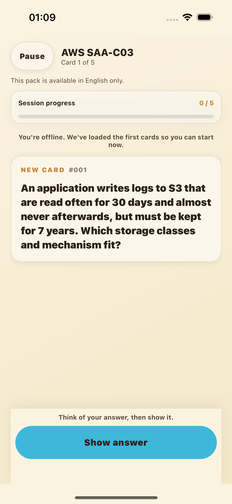
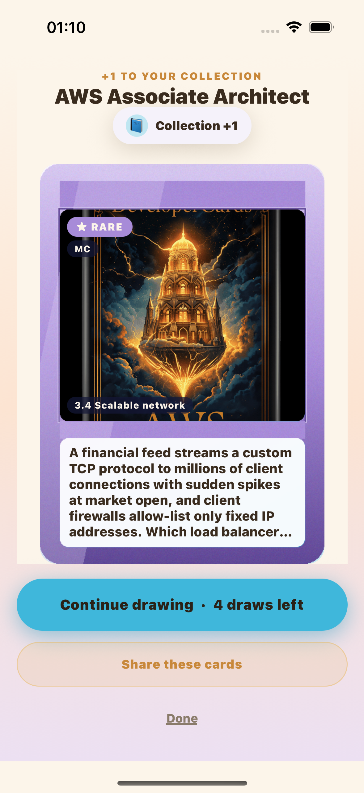
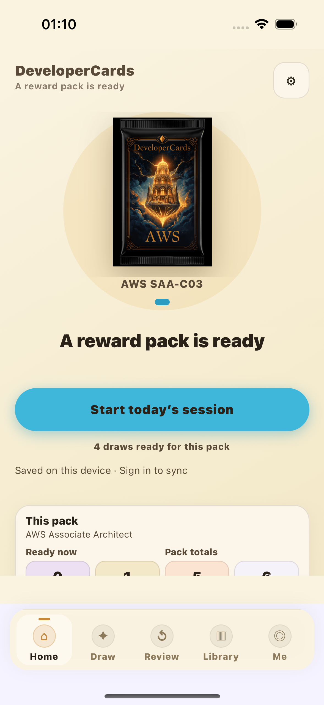

# Native guest journey — isolated iOS Simulator QA

The current guest main path ran visibly in Maestro: onboarding → install bundled SAA-C03 starter → study five cards → receive five bootstrap draws → open one card with the native swipe gesture → result → Home → terminate/relaunch. A separate restart compares durable content, progress, wallet, collection, history, goal and onboarding state. This is local Simulator QA evidence, produced for independent review.

## Artifact and device identity

| Item | Recorded identity |
| --- | --- |
| Business source | `63f55b945a64149d514961936b7d84bea191a8e9` |
| App ID | `com.timeawake.recallsmith.career.b2` |
| Simulator | Fresh `RecallSmith B2 Isolated QA 20261027`, iPhone 16 |
| UDID | `DC862F4C-7531-4EF2-8264-E9291ADF1156` |
| OS | iOS 18.5, build 22F77, arm64 Simulator |
| Tools | Maestro 2.11.0; Xcode 27.0 / 27A266a |
| Reused native shell | DeveloperCardsQA 2.1.0 (25), originally `com.timeawake.recallsmith.qa` |
| Original shell executable SHA-256 | `732fc5a9f162f3bbac71e99af6ad586808564c43569316c228823d1e20505a75` |
| Fresh current JS bundle SHA-256 | `bd1c8192fb911c4ee84df4610867bd48da86bd312a50618a717388c156483b9d` |

The original shell is the brief's installed `DeveloperCardsQA.app` under Simulator `B16EDA9F-91FE-449E-8774-873C44D26D07`, bundle-container `C5D34488-4513-4A08-B574-882536EE86D6`. The build script reads it, compares all declared native dependencies with its original `workspaces/recallsmith-v210/mobile/package.json`, copies it, and verifies every original file hash remains unchanged. The original workspace and installed app were not edited or launched. The reused shell retains the prior local RevenueCat Xcode 27 initializer backport. It is not a newly compiled production shell or TestFlight binary.

`evidence/B2-security-refresh/build/artifact.json` records every original and copied artifact file hash, native adaptations, QA source hashes, bundle hash and build commands. This refresh rebuilt and reran the unchanged harness after the targeted undici lock update. The shipping business code is unchanged; the captured source includes the updated lockfiles. Original harness-authoring evidence is retained under `evidence/B2`.

## Isolation and exercised logic

The alternate `tests/native/offline-entry.js` is selected only by the local builder; the shipping `index.ts` is unchanged. It denies fetch, XHR and WebSocket before importing App, rejects native FileSystem remote downloads/uploads, and allows only `file://` downloads so the real bundled starter installer still executes. No deck, progress, wallet, reward or collection state is seeded or replaced. Cognito, RevenueCat and Sentry credentials/config are not forwarded; the bundler gets an explicit environment allow-list, `EXPO_NO_DOTENV=1`, fake `.invalid` API/content hosts, telemetry disabled and Sentry uploads disabled.

The copied native package has a new app ID, no URL handlers, sanitized Expo constants and OTA disabled (`EXUpdatesEnabled=false`, check `NEVER`). A process-local `B2NetworkDeny.dylib` is added persistently to the copied Mach-O's load commands and the package is ad-hoc signed. It registers a rejecting NSURLProtocol and interposes socket connect/connectx/sendto/sendmsg. There is no launch-only injection environment, launchctl setting, proxy, certificate, system network change or modification to another app. Every new app process checks a separate-image loopback socket canary (`EACCES`) and a native NSURLSession `.invalid` canary (offline); a failed check aborts. Restart evidence confirms the successful canary count increases. This guard is a local QA adaptation, not a shipping security mechanism.

The test selects SAA-C03 because this source bundles its starter pack. The normal SessionCard fallback installs the local 30-card pack through `ensureStarterDeckInstalled` and `installDeckAndInvalidate`. It completes the five-card first lesson with visible Show answer / Got it actions; the real `commitRating` path records learning, and the existing lesson completion grants five bootstrap draws. Opening one draw uses the real local wallet and draw engine, then performs the visible right-swipe and result action. The notification prompt is skipped with Not now; no system reminder permission is requested.

## Results and raw evidence

Evidence root on this machine:

`/Users/qc/.local/share/codex-workflows/recallsmith/career-readiness-20261026/evidence/B2-security-refresh`

| Check | Evidence |
| --- | --- |
| Main path PASS | `run/native-guest-main-path.xml` and raw commands/screenshots under `run/native-guest-main-path/`; 51.798 seconds |
| Additional terminate/relaunch and exact durable state comparison PASS | `run/result.json`, before/after restart JSON, native guard logs and `run/native-relaunch-persistence.xml`; 4.157 seconds |
| Complete refresh sequence | `sequence.json`; boot, install, runner and shutdown all exited 0 |
| JS guard and native isolation | Unchanged guard source; fresh run verifies protected new processes and exact business state |
| Artifact integrity | `build/artifact.json`, bundle/compiler/codesign logs; original shell remains unchanged |
| Device identity | Same dedicated iPhone 16 / iOS 18.5 Simulator, shut down after this run |

The persisted assertions require 30 installed progress entries with five reviewed cards, a 4 available / 0 reserve wallet, one drawn UID and matching single draw-history entry, and onboarding `done`. All nine selected business storage entries must remain deeply equal after restart. The native canary log must show a new protected process. The drawn card varies because the real draw engine is used; no fixed rarity or UID is injected.

Initial harness-authoring failures are retained under `evidence/B2`: native build attempt 1 exported current JS but intentionally aborted on a misplaced socket canary in the interposer's own image; attempt 2 had a local linker filename error; attempt 3 built and launched successfully. Maestro discovery run 1 used an obsolete rating selector, and run 2 omitted the visible pack swipe. Run 3 uses the current study actions and real gesture. These are harness authoring failures, not asserted product defects. No SDK/dependency upgrade was attempted.

## Re-run locally

Use an empty evidence output directory for each build/run. The builder refuses to overwrite an existing output and checks dependency declarations before shell reuse. Substitute the brief's exact source shell and original shell package paths; do not run the old QA builder, which has a different network/configuration scope.

```sh
cd /Users/qc/src/recallsmith-career-native-20261026
node mobile/tests/native/offline-entry.test.cjs
python3 mobile/scripts/build-native-journey-qa.py \
  --shell /absolute/path/to/DeveloperCardsQA.app \
  --shell-package /absolute/path/to/recallsmith-v210/mobile/package.json \
  --output /absolute/path/to/new-evidence-build
xcrun simctl create 'RecallSmith B2 Isolated QA rerun' \
  com.apple.CoreSimulator.SimDeviceType.iPhone-16 \
  com.apple.CoreSimulator.SimRuntime.iOS-18-5
# Use the newly returned UDID in every following command.
xcrun simctl boot NEW_UDID
xcrun simctl bootstatus NEW_UDID -b
xcrun simctl install NEW_UDID /absolute/path/to/new-evidence-build/RecallSmithB2.app
python3 mobile/scripts/run-native-journey-qa.py \
  --device NEW_UDID --output /absolute/path/to/new-evidence-run
xcrun simctl shutdown NEW_UDID
```

The runner requires the dedicated Simulator name prefix and fixed QA app ID. Its first launch clears only that app. Subsequent launches preserve its state; it never erases the Simulator or touches a phone. No EAS/cloud invocation, upload, credentials/env-file read, production mutation, paid call, package install, lockfile change or push is part of this workflow.

## Actual captures

All three images below are unedited Maestro screenshots from the post-lock-update refresh on the isolated iOS 18.5 iPhone 16 Simulator, app `com.timeawake.recallsmith.career.b2`, using the reused QA native shell and freshly exported current-source JS described above.



Current offline starter installed through the real local installer; no remote content service was contacted.



The real local draw result after spending one of the five lesson bootstrap draws.



Home after app termination/relaunch, with four draws ready and local-save status. The exact durable state is separately compared in JSON rather than inferred from the screenshot.

## Limits

Production auth, cross-device sync, paid entitlement/purchases, production content delivery, OTA behavior in a production binary, physical-device behavior, VoiceOver quality and frame rate/performance remain **UNKNOWN / not tested**. Simulator UI visibility and a skipped remainder of the reveal animation do not establish those properties. This run validates the local guest/offline path and persistent native launch isolation within the stated QA shell adaptations.
